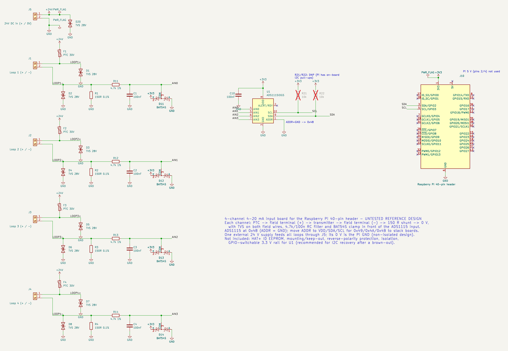

# 4-channel 4-20 mA Raspberry Pi add-on board: reference design

> **UNTESTED REFERENCE DESIGN.** Nobody has laid out, built or tested a board from this
> schematic. It has passed `kicad-cli` ERC and an automated netlist check, and that is all.
> It has no PCB layout, no ID EEPROM and no isolation (see "Not included").
> Treat it as a schematic starting point.
>
> **Monitoring and telemetry only.** Do not use this board as part of a gas-detection
> safety function.

Files: [`.kicad_sch`](../hardware/hat-4ch/ads1115-4-20ma-hat-4ch.kicad_sch) (KiCad 9),
[SVG](../hardware/hat-4ch/ads1115-4-20ma-hat-4ch.svg),
[PNG](../hardware/hat-4ch/ads1115-4-20ma-hat-4ch.png),
[PDF](../hardware/hat-4ch/ads1115-4-20ma-hat-4ch.pdf).

## What is on it

* **J5: 24 V loop-supply input** (+ / 0 V) with D20, a TVS of 28 V standoff class.
  The 0 V is the Pi's GND, so the design is non-isolated.
* **Four identical channels** (J1–J4). Each is the [single-channel circuit](wiring-single-channel.md):
  * a PTC (F1–F4) from +24 V to the field terminal's `+`;
  * a TVS on both field wires (D1–D8);
  * a 150 Ω 0.1 % shunt (R1–R4);
  * a 4.7 kΩ / 100 nF filter (R11–R14, C1–C4);
  * a BAT54S clamp (D11–D14) into AIN0–AIN3.
* **U1 ADS1115** at 0x48 (ADDR = GND), powered from the Pi's 3.3 V.
  * Move ADDR to VDD, SDA or SCL to get 0x49, 0x4A or 0x4B. That lets up to four boards share one bus, for 16 loops.
* **I²C** goes to header pins 3/5 (GPIO2/3). It uses the Pi's own 1.8 kΩ pull-ups; R21/R22 are DNP.
* **The Pi's 5 V is not used.** Only 3.3 V (pin 1) and GND are taken from the header.

All four channels share the four ADS1115 inputs. The mqttpi driver reads them one after
another; a per-chip lock serialises the conversions.

## Not included (do these before calling it a product)

* **HAT+ compliance.**
  * The [Raspberry Pi HAT+ specification](https://pip-assets.raspberrypi.com/categories/1215-raspberry-pi-hat/documents/RP-008281-DS-1-hat-plus-specification.pdf) requires an ID EEPROM on ID_SD/ID_SC (with 3.9 kΩ pull-ups) and mechanical attachment to the Pi. It also requires the board to tolerate the STANDBY state, where 5 V is on and 3.3 V is off.
  * This board has no EEPROM. ID_SD/ID_SC are left unconnected, as the spec requires for anything other than the EEPROM. So strictly it is an add-on board, not a HAT+.
  * In STANDBY with the loop supply on, the inputs back-feed the dead 3.3 V rail through the 4.7 kΩ resistors (≤ ~4.3 mA per channel, see [the single-channel notes](wiring-single-channel.md#protection)).
* **A GPIO-switchable 3.3 V rail for U1.** Recommended so a bus that is stuck after a brown-out can be recovered by power-cycling the ADC.
* **Reverse-polarity protection** on J5. Also consider a per-board fuse.
* **Galvanic isolation.** You need it if any transmitter or supply is referenced to a different ground. Use loop isolators, or an isolated ADC board (see below).
* **A PCB layout.** Keep the shunts away from heat sources. Run Kelvin-style traces from each shunt to its RC filter, and give the field side and the Pi side a single ground star point.

## Commercial alternatives

If you would rather buy hardware, these exist. Each was checked on the vendor page in
October 2026; the details are as stated on those pages. This list is not an endorsement,
and none of them has been tested with this plugin.

| Product | What the vendor page says | Notes for this plugin |
|---------|---------------------------|-----------------------|
| [Sequent Microsystems Industrial Automation HAT](https://sequentmicrosystems.com/products/industrial-automation-for-raspberry-pi) | Four optically isolated 4-20 mA inputs (150 Ω input impedance, 12-bit, external loop supply up to 24 V) plus other I/O. I²C, with an on-board processor. Pi Zero to Pi 5. | Uses Sequent's own I²C protocol, not a bare ADS1115, so this driver does **not** talk to it. Use the vendor's software. Isolated inputs are a real advantage for mixed-ground sites. |
| [Sequent Microsystems Sixteen Analog/Digital Inputs HAT](https://sequentmicrosystems.com/products/sixteen-analog-digital-inputs-8-layer-stackable-hat-for-raspberry-pi) | 16 universal inputs; each can be set in software to 4-20 mA, 0-10 V, 0-3.3 V, thermistor or contact. I²C 0x58–0x5F, stackable. | Vendor protocol, not ADS1115. |
| [NCD 4-Channel 4-20 mA Current Loop Receiver, 16-bit ADS1115 I²C Mini Module](https://store.ncd.io/product/4-channel-4-20-ma-current-loop-receiver-16-bit-ads1115-i2c-mini-module/) | ADS1115 plus INA196 current-shunt monitors. On-board 16 V loop supply boosted from 5 V. 5 V nodeLynk I²C; needs a nodeLynk adapter for the Pi. The vendor says to use gain 2: about 6430 counts at 4 mA and 32154 at 20 mA. | ADS1115-based, but the front end is an amplifier, not a bare shunt, so do not use `shunt_ohms: 150`. Use voltage mode with `gain: 2` and a `scale` from NCD's figures (calibrate). |
| [Waveshare Modbus RTU Analog Input 8CH](https://www.waveshare.com/product/iot-communication/modbus-rtu-analog-input-8ch.htm) | 8-channel isolated RS485 Modbus RTU module. 12-bit. 249 Ω sampling resistor (499 Ω on the "(B)" version). DIN rail. | Not a HAT, and needs a Modbus client. Out of scope for this driver. |
| [iQuest iQLF4A20M8C 8-channel 4-20 mA HAT](https://i-quest.co/product/iqlf4a20m8c-iquest-low-frequency-8-channel-4-20ma-current-loop-hat-for-raspberry-pi/) | Two ADS1115 (0x49 for channels 1–4, 0x48 for channels 5–8). 250 Ω resistors, so 4-20 mA becomes 1–5 V. I²C at 3.3 V levels. | ADS1115-based. 5 V at 20 mA is above what a 3.3 V-powered ADS1115 may see (VDD + 0.3 V). The page does not say how the ADCs are powered, so check with the vendor first. If they run from 5 V, use `shunt_ohms: 250`, `supply_v: 5.0` and `gain: 2/3` (±6.144 V). |

## Pico W compatibility

* **Electrically**, an ADS1115 and the shunt and protection front end work with a Raspberry Pi
  Pico W. The Pico W's GPIO is 3.3 V, and the chip only needs I²C plus 3.3 V and GND.
* **Mechanically**, this board's 40-pin header does **not** fit a Pico W. You would wire
  SDA/SCL/3V3/GND to the Pico's I²C pins yourself.
* **In software**, this repository is a plugin for mqttpi's **Linux daemon**. It uses CPython
  and `smbus2`. mqttpi's Pico W side runs differently: see mqttpi's
  [`analog-inputs.md`](https://github.com/carefreeinv/mqttpi/blob/main/examples/analog-inputs.md),
  which describes the Pico W `analog_input` as config-only. So this driver does not run on a
  Pico W as-is.
* The conversion and fault logic in `mqttpi_4_20ma/loop.py` is pure Python with no
  dependencies. It could be ported to MicroPython.
* The Pico W's own 12-bit ADC (GP26–GP28) could read a shunt directly, but with less resolution.
  The same input protection and the 3.3 V input limit apply.
