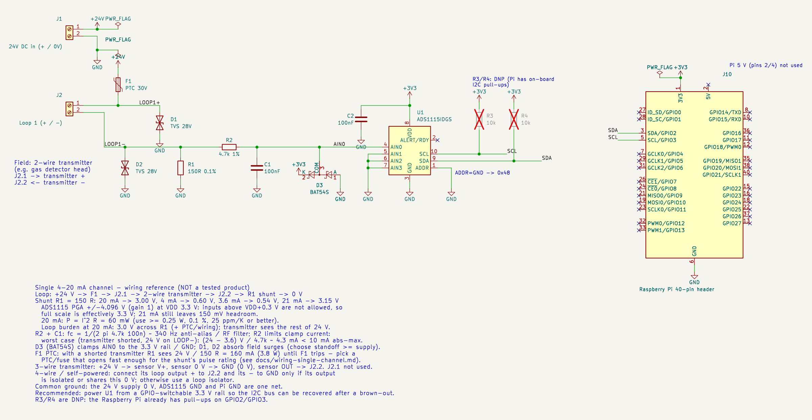

# [gas-detector-4-20ma.yaml](gas-detector-4-20ma.yaml)

## Purpose / when to use

Two **4-20 mA gas transmitters** (combustible gas in %LEL and H2S in ppm) on one **ADS1115**
at I²C address **0x48**. Each loop is read across a **150 Ω 0.1 % shunt** and published to
Home Assistant as a sensor. Each sensor also gets a loop-current entity and a loop-fault
diagnostic entity.

Use it for:

* 2-wire loop-powered (or 3-wire) process transmitters: gas, pressure, level, flow, temperature
* Any 4-20 mA signal you want in Home Assistant with open-loop detection

> **Monitoring / telemetry only.** Gas detection is life-safety equipment. This does
> not replace a certified gas-detection controller, its alarm relays, or the
> transmitter's own alarm outputs. Don't build alarms or interlocks on these entities.

## Quick start

```bash
pip install "mqttpi-4-20ma @ git+https://github.com/carefreeinv/mqttpi-4-20ma"
cp examples/gas-detector-4-20ma.yaml config.yaml
# Edit device.id, mqtt.host, and each pin's scale to match your transmitters' ranges
mqttpi-4-20ma -c config.yaml        # same options as the mqttpi command
```

**Wiring:** [docs/wiring-single-channel.md](../docs/wiring-single-channel.md).

* Loop: +24 V → PTC → transmitter → shunt → 0 V.
* The shunt's top connects to AINx through 4.7 kΩ / 100 nF and the clamp.
* The ADS1115 runs from the Pi's 3.3 V. SDA goes to pin 3, SCL to pin 5.
* The loop supply's 0 V must connect to the Pi's GND.



## Board, profile, peripheral toggles

| Setting | Value |
|---------|-------|
| **Board** | `pi4` (any 40-pin Raspberry Pi running the mqttpi Linux daemon) |
| **I²C** | enabled, controller 1, SDA GPIO2 / SCL GPIO3 |
| **ADS1115** | 0x48 (ADDR → GND), gain 1 (±4.096 V), 128 SPS |
| **Other buses** | not used |

## Pin map

| ADS1115 input | Alias | Loop | Scale (4 → 20 mA) | Smoothing | Interval |
|---------------|-------|------|-------------------|-----------|----------|
| AIN0 | `gas_lel` | 4-20 mA across 150 Ω | 0 → 100 %LEL | EMA α 0.5, 4× oversample | 2 s |
| AIN1 | `gas_h2s` | 4-20 mA across 150 Ω | 0 → 100 ppm | off | 2 s |
| AIN2, AIN3 | — | unused, tie to GND | — | — | — |

## MQTT and Home Assistant entities

With `base_topic: mqttpi/gas-01`, each loop yields three HA sensors. Every entity has
`{base_topic}/sensors/<alias>/state|attributes|availability`, plus the device-wide
`mqttpi/gas-01/status`.

| Entity alias | HA name | Unit | Notes |
|--------------|---------|------|-------|
| `gas_lel` | Combustible Gas | %LEL | Engineering value. **Unavailable** while the loop is faulted. |
| `gas_lel_current` | Combustible Gas loop current | mA | Diagnostic. Always published, including during a fault. |
| `gas_lel_loop_fault` | Combustible Gas loop fault | — | Diagnostic. 0 ok, 1 under range, 2 over range, 3 fault low (open loop), 4 fault high. |
| `gas_h2s`, `gas_h2s_current`, `gas_h2s_loop_fault` | H2S … | ppm / mA / — | Same pattern. |

The JSON on `…/attributes` includes:

* `loop_status` (`ok`, `under_range`, `over_range`, `fault_low`, `fault_high`)
* `current_ma`, `voltage`, `raw`, `quality`, `timestamp`

Discovery payloads are pinned by the snapshot `tests/snapshots/gas_discovery.json`.

### Fault behaviour (NAMUR NE43 defaults)

| Loop current | Status | Value entity | Quality |
|--------------|--------|--------------|---------|
| ≤ 3.6 mA | `fault_low` (open loop / broken wire / transmitter fault) | unavailable | uncertain |
| 3.6 – 4.0 mA | `under_range` | published (below range_min) | uncertain |
| 4.0 – 20.0 mA | `ok` | published | good |
| 20.0 – 21.0 mA | `over_range` | published (above range_max) | uncertain |
| ≥ 21.0 mA | `fault_high` | unavailable | uncertain |

Set `fault: { low_ma, high_ma }` per pin to change the limits. Set `clamp: true` to clamp
under/over-range values to the 4–20 mA scale.

## Design decisions

* **150 Ω shunt.** 20 mA gives 3.0 V, and the 21 mA fault limit gives 3.15 V. Both fit
  under VDD = 3.3 V at gain 1, with about 0.83 µA per count. A 250 Ω (1–5 V) shunt would
  exceed the ADS1115's input range at 3.3 V.
* **Same `pins[]` schema as mqttpi.** mqttpi's `analog-inputs.yaml` documents the
  `source: ads1115` contract. This example adds only optional keys: `shunt_ohms`, `loop`,
  `fault`, `smoothing`, `oversample`, `clamp` and `supply_v`. Plain mqttpi ignores them.
* **Value goes unavailable on a fault**, rather than freezing at the last good value or
  publishing 0. HA then shows the reading as unknown instead of "0 %LEL". The current and
  fault entities stay online so you can see why.
* **2 s interval.** This is a balance between broker load and responsiveness for telemetry.
  It is not an alarm response time.

## FAQ

**Q: My transmitter outputs below 4 mA during warm-up or calibration.**
A: Many gas transmitters use sub-4 mA levels for maintenance or fault states. Check the manual.
With the defaults, anything ≤ 3.6 mA shows as `fault_low`. Raise or lower `fault.low_ma`
to match your transmitter's levels.

**Q: Can I read a plain voltage instead?**
A: Yes. Omit `loop` and `shunt_ohms`; the entry then publishes volts, scaled by `ha.scale`. That
is mqttpi's documented `supply_voltage` example.

**Q: More channels?**
A: Use AIN2/AIN3, or add ADS1115s at 0x49–0x4B. The 4-channel reference design is in
[docs/hat-reference.md](../docs/hat-reference.md).

**Q: Does this run on a Pico W?**
A: No, this plugin needs mqttpi's Linux daemon. See [docs/hat-reference.md](../docs/hat-reference.md#pico-w-compatibility).

## Implementation status

The driver, config mapping and HA publishing are **implemented and unit-tested**, using a fake
I²C bus and no hardware. They have **not** yet been tested against real transmitters, and the
schematics are untested reference designs.
